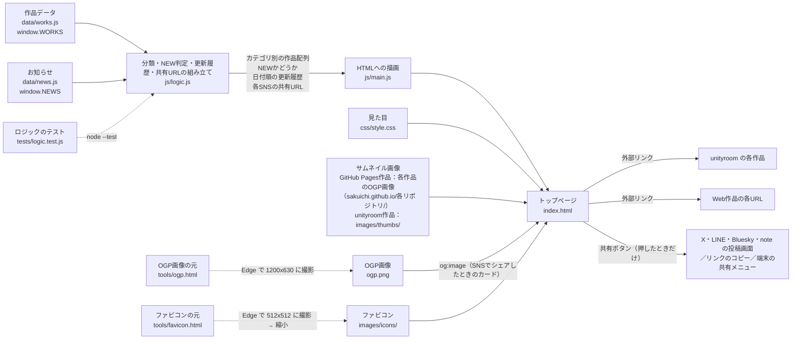

# おもしろゲーム倉庫 構成

素の HTML/CSS/JS で作った静的サイト。GitHub Pages にそのまま置く。
作品データは `.js` ファイルにまとめてあるので、`index.html` をダブルクリックするだけでローカル確認できる（ローカルサーバー不要）。

## 処理フロー



OGP画像の撮り直し（Windows / Edge）:

```
msedge --headless --hide-scrollbars --window-size=1200,630 --screenshot=ogp.png tools/ogp.html
```

ファビコンの作り直し: `tools/favicon.html` を同じ方法で 512x512 に撮影し、48px（`icon-48.png`、検索結果用）・192px（`icon-192.png`）・180px（`apple-touch-icon.png`、iPhone のホーム画面用）に縮小して `images/icons/` に置く（Windows PowerShell の System.Drawing で縮小した）。

## 検索エンジン向けの設定

- `index.html` に title・description・canonical（`https://sakuichi.github.io/portfolio/`）を指定している。
- `tools/` のHTMLは画像を作るための作業用ページなので `noindex` を付けている。
- `.nojekyll` を置いて GitHub Pages の Jekyll 変換を止めている（止めないと `docs/architecture.md` が HTML ページとして公開され、検索結果に出るおそれがある）。

## 受け渡すデータ

### 作品（`data/works.js` の `window.WORKS` の要素）

| キー | 内容 | 例 |
|---|---|---|
| `title` | 作品名 | `"ねこ積みタワー"` |
| `category` | `"game"` または `"web"` | `"game"` |
| `platform` | 表示用の置き場所名 | `"unityroom"` / `"ブラウザ"` |
| `url` | 遊ぶ・見るためのURL | `"https://unityroom.com/games/xxxx"` |
| `thumb` | サムネイル画像のURLまたはパス（空ならNO IMAGE表示）。GitHub Pagesの作品はOGP画像（1200x630）を直接参照、unityroomの作品はアイコンを `images/thumbs/` にコピー | `"https://sakuichi.github.io/kusha-poi/ogp.png"` |
| `description` | ひとこと紹介 | `"ねこを積むだけ。"` |
| `date` | 公開日 `YYYY-MM-DD` | `"2026-10-20"` |

### お知らせ（`data/news.js` の `window.NEWS` の要素）

作品の公開は更新履歴に自動で載るので、それ以外（サイト開設など）だけ書く。

| キー | 内容 |
|---|---|
| `date` | `YYYY-MM-DD` |
| `text` | 表示する文 |

## ルール

- 公開日から30日未満の作品に「NEW!」を付ける（`js/logic.js` の `NEW_DAYS`）。
- 更新履歴は「作品の公開」と「お知らせ」を新しい順に混ぜて表示する。
- 共有ボタンはSNS公式のスクリプトを使わず、ただのリンクにする（押すまでSNSに何も送らない）。共有するURLは常に `https://sakuichi.github.io/portfolio/`（`js/main.js` の `SITE_URL`）。
